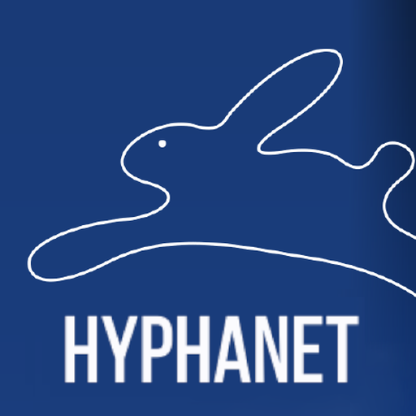

<!--
Ce README est la version française du README généré pour ce dépôt.
-->

<h1>
  
  Freenet, packagé pour YunoHost
</h1>

Réseau résistant à la censure pour publier et naviguer anonymement


## Aperçu

Freenet est une plateforme de communication et de publication résistante à la
censure. C'est un logiciel pair-à-pair qui fournit un magasin de données
distribué, chiffré et décentralisé. Des sites et applications (forums,
messageries) sont construits par-dessus. Ce paquet installe le Freenet
REference Daemon (fred) et expose son interface web (fproxy) via l'URL de
l'app.

## Installation

Cette app n'est pas encore au catalogue YunoHost. Installez-la depuis ce dépôt :

```bash
sudo yunohost app install https://github.com/quartztester/hyphanet_ynh
```

## Informations développeur

Dépôt amont de Freenet : <https://github.com/hyphanet/fred>

Documentation de packaging : <https://doc.yunohost.org/dev/packaging/>
